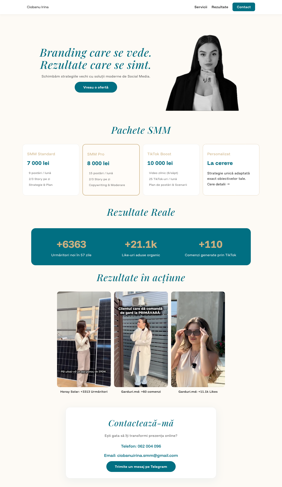
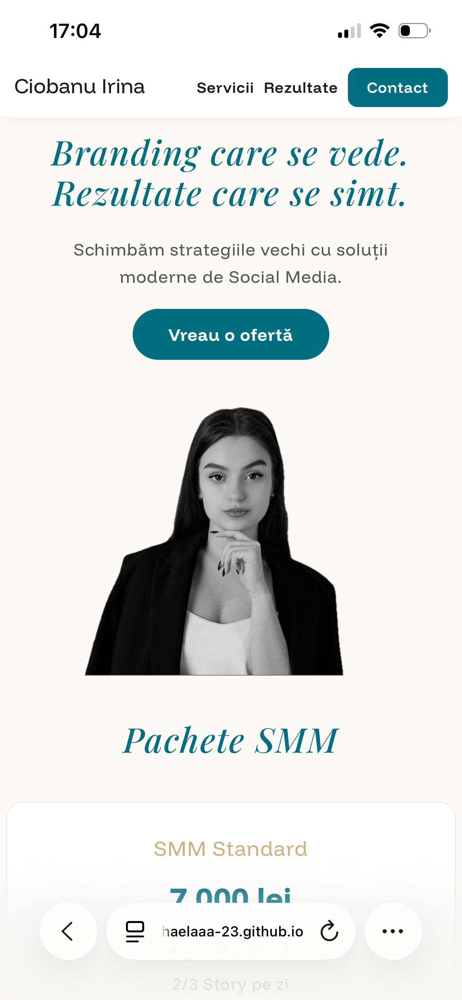
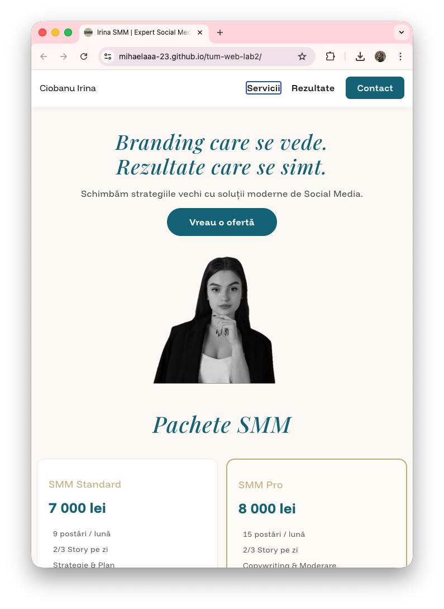

# Irina SMM - Social Media Management Landing Page

Romanian-language, static landing page for Ciobanu Irina's SMM services: packages, results, journal, reviews and direct contact.

## Stack

- Astro 5 (static output) in `site/`
- Tailwind CSS 4 (via `@tailwindcss/vite`), design tokens in `site/src/styles/tokens.css`
- TinaCMS for editing the JSON content in `site/content/`
- Vitest (unit) and Playwright with axe (e2e, 4 viewport projects: 320, 768, 1024, 1440)
- Hosting on GitHub Pages; Netlify deploy previews for the `redesign` branch

## Design

Colors: teal `#026E82`, teal deep `#014E5C`, teal mist `#E4F0EF`, cream `#FBF7F1`, paper dot `#E9DFD3`, ink `#1E1715`, ink muted `#5D514B`, blush `#F2C9CF`, leopard tan `#C9935C`, leopard spot `#3B2418`.

Fonts (self-hosted via Fontsource, no Google Fonts requests): Gloock (display), Hanken Grotesk variable (body/UI), Caveat (short hand-written asides).

Motion is limited to scroll reveals, a one-time polaroid settle and a highlight draw-in, all disabled under `prefers-reduced-motion: reduce`.

## Scripts

Run from `site/`:

- `npm run dev` - TinaCMS + Astro dev server
- `npm run build` - optimize images and build to `site/dist`
- `npm run preview` - serve the production build
- `npm test` - unit tests, then e2e tests
- `npm run test:unit` - Vitest only
- `npm run test:e2e` - Playwright only (builds and previews the site automatically)

## Preview flow

Work happens on the `redesign` branch. Pushing it creates a Netlify deploy preview (noindex). Review the preview, then merge `redesign` into `main`; the GitHub Actions workflow publishes `main` to GitHub Pages.

## Screenshots

> These screenshots show the previous design (before the teal scrapbook redesign).

### Desktop View

<!--  -->

### Mobile View

  

### Tablet View

## Live Demo

**[View Live Demo →](https://mihaelaaa-23.github.io/tum-web-lab2/)**
